<p align="center">
  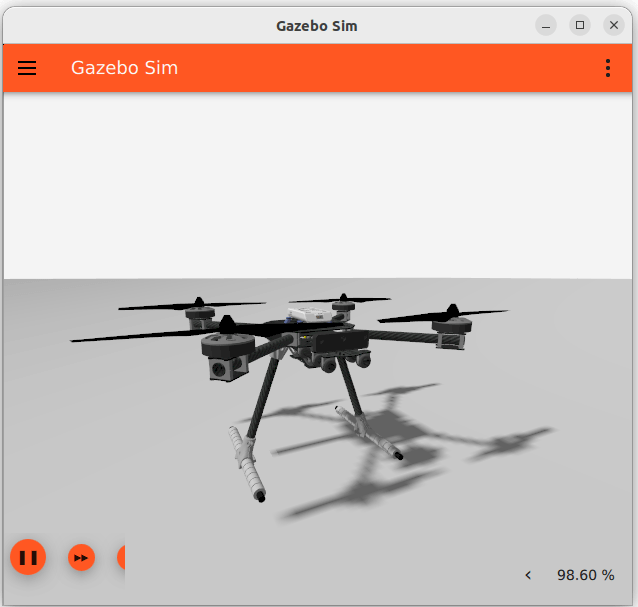
</p>

<h1 align="center">Collaborative Tracking of a Moving Target by Two Drones</h1>

<p align="center">
  <strong>End-of-Year Engineering Project (PFA) — ENIT, Universite de Tunis El Manar</strong><br/>
  <em>Multi-Drone Autonomous Tracking with AI-Based Collision Avoidance</em>
</p>

<p align="center">
  
  
  
  
  
  
</p>

---

## Table of Contents

- [Overview](#-overview)
- [System Architecture](#-system-architecture)
- [Key Features](#-key-features)
- [Technology Stack](#-technology-stack)
- [Detection — YOLOv8](#-detection--yolov8)
- [Control — Multi-Axis PID](#-control--multi-axis-pid)
- [Collision Avoidance — PPO Reinforcement Learning](#-collision-avoidance--ppo-reinforcement-learning)
- [Simulation Environment](#-simulation-environment)
- [HITL — Hardware-in-the-Loop with Jetson Nano](#-hitl--hardware-in-the-loop-with-jetson-nano)
- [Results](#-results)
- [Project Structure](#-project-structure)
- [License](#-license)

---

## Overview

This project implements a **fully autonomous collaborative tracking system** where **two drones** cooperatively track a **moving human target** in a realistic outdoor simulation. The system combines **computer vision (YOLOv8)**, **state estimation (Kalman Filter)**, **multi-axis PID control**, and **reinforcement learning (PPO)** for intelligent collision avoidance between drones.

The architecture follows a **Hardware-in-the-Loop (HITL)** paradigm, with heavy AI inference (YOLO + PPO) offloaded to an **NVIDIA Jetson Nano**, while real-time PID control runs on the host PC, connected via **WebSocket**.

### What Makes This Project Unique

| Aspect | Description |
|--------|-------------|
| **Multi-Drone** | Two drones coordinate simultaneously on a shared target |
| **Hybrid AI + Control** | PID handles tracking; PPO RL handles inter-drone safety |
| **HITL Architecture** | Jetson Nano runs inference, PC runs control — connected via WebSocket |
| **Kalman Filtering** | Robust target prediction during occlusion and detection loss |
| **State Machine** | Fully autonomous state transitions (Idle - Hover - Search - Track - Safety) |

---

## System Architecture

<p align="center">
  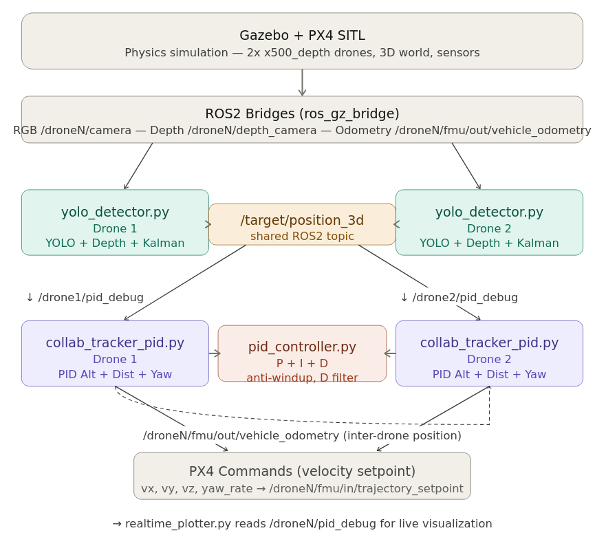
</p>

The system is composed of modular ROS2 nodes communicating through a well-defined topic graph:

```
HOST PC (Ubuntu 22.04)

  PX4 SITL Drone 1  <-->  PX4 SITL Drone 2  <-->  Gazebo Garden
         |                        |
  PID Tracker D1           PID Tracker D2    <-- collab_tracker_pid.py
         |                        |
         +----------+-------------+
                    | WebSocket
                    v
            JETSON NANO
          - YOLOv8 (ONNX)
          - PPO Agent (ONNX)
          - ws_server.py
```

---

## Key Features

### Perception
- **YOLOv8n** person detection on each drone's camera feed
- **Depth camera** integration for metric 3D target localization
- **Kalman Filter** for smooth target state estimation and occlusion handling
- Detection confidence + Kalman prediction during target loss

### Control
- **4-axis PID controllers** (distance, altitude, yaw, tangential positioning)
- Anti-windup with integral clamping and derivative low-pass filtering
- Configurable gains for per-axis tuning
- 20 Hz control loop

### Intelligence
- **PPO (Proximal Policy Optimization)** agent for inter-drone collision avoidance
- Custom Gymnasium environment modeling the dual-drone interaction space
- 12-dimensional observation vector (relative positions, velocities, angles)
- 7 discrete actions (tangential/radial adjustments per drone)
- Trained for 3M steps with 8 parallel environments

### Orchestration
- Fully autonomous **state machine** with 6 states
- Automatic takeoff, hover, search, track, and safety separation
- WebSocket-based HITL communication (PC <-> Jetson)

---

## Technology Stack

| Category | Technology |
|----------|------------|
| **Middleware** | ROS2 Humble |
| **Flight Controller** | PX4 Autopilot (SITL) |
| **Simulator** | Gazebo Garden |
| **Detection** | YOLOv8n (Ultralytics) + ONNX Runtime |
| **State Estimation** | Custom Kalman Filter |
| **Control** | Multi-axis PID with anti-windup |
| **RL Framework** | Stable-Baselines3 (PPO) + Gymnasium |
| **Edge Compute** | NVIDIA Jetson Nano (4GB) |
| **Communication** | WebSocket (asyncio) |
| **Languages** | Python 3.10, Bash |
| **OS** | Ubuntu 22.04 LTS |

---

## Detection — YOLOv8

Each drone runs a **YOLOv8n** model to detect persons in its camera feed. The detection pipeline:

1. **Frame capture** from Gazebo camera via ROS2 bridge
2. **YOLOv8 inference** (person class only, `class=[0]`)
3. **Depth estimation** from depth camera sensor (fallback: focal-length-based estimation)
4. **3D localization** using camera geometry + drone pose
5. **Kalman filtering** for trajectory smoothing and prediction

<p align="center">
  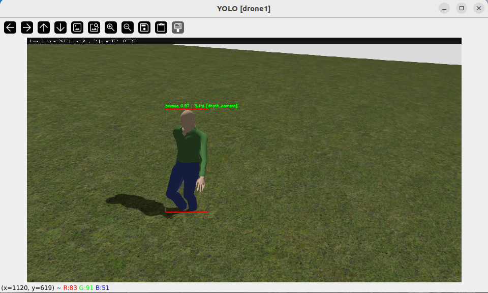
  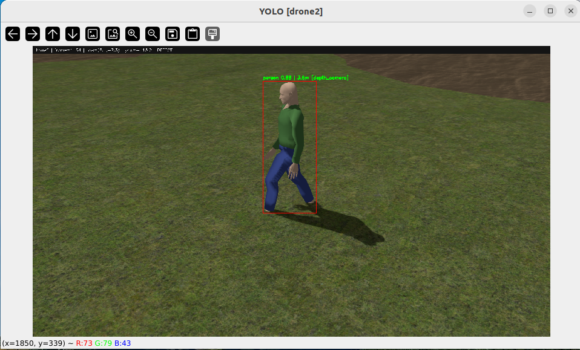
</p>
<p align="center"><em>Real-time YOLOv8 detection from both drones' perspectives with distance estimation overlay</em></p>

---

## Control — Multi-Axis PID

The tracking controller uses **4 independent PID controllers**, each with anti-windup and derivative filtering:

<p align="center">
  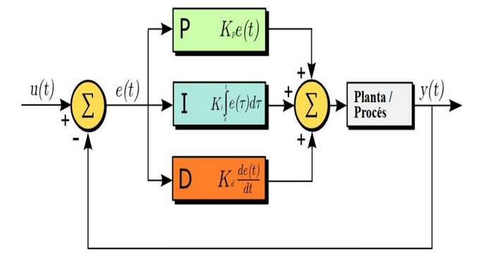
</p>

| Axis | Purpose | Features |
|------|---------|----------|
| **Distance** | Maintain 3.5m from target | Anti-windup, derivative filtering |
| **Altitude** | Hold 2.5m flight altitude | Integral clamping |
| **Yaw** | Face the target | Proportional dominant |
| **Tangential** | Maintain 90 deg angular separation | Coordinated between drones |

`python
class PIDController:
    """
    Discrete PID controller with:
      - Anti-windup (integral clamping)
      - Derivative low-pass filter (1st order)
      - Output saturation
    """
    def compute(self, error, dt=None):
        p_term = self.kp * error
        self._integral += error * dt  # clamped
        d_term = self.kd * filtered_derivative
        return clamp(p_term + i_term + d_term)
`

---

## Collision Avoidance — PPO Reinforcement Learning

A PPO agent trained with **Stable-Baselines3** manages inter-drone separation. It operates **only** when the PID tracker would cause the drones to collide — the RL agent's sole responsibility is safety.

### Observation Space (12D)
`
[dx, dy, inter_distance, d1_to_target, d2_to_target, angular_separation,
 vx_drone1, vy_drone1, vx_drone2, vy_drone2, phase_indicator, closing_speed]
`

### Action Space (Discrete, 7 actions)
<p align="center">
  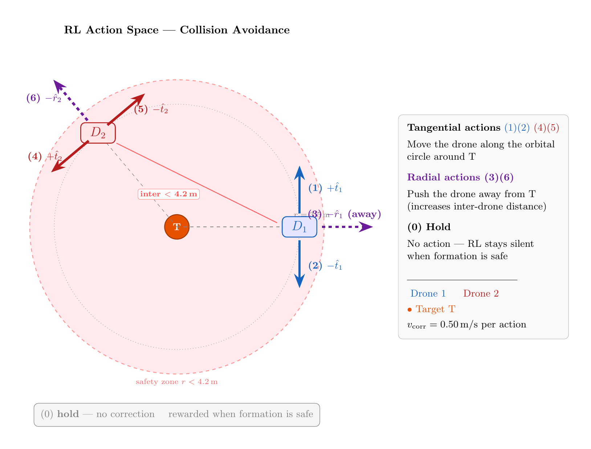
</p>

| Action | Effect |
|--------|--------|
| 0 | No intervention (hold) |
| 1-2 | Drone 1 tangential adjustment |
| 3 | Drone 1 radial push-away |
| 4-5 | Drone 2 tangential adjustment |
| 6 | Drone 2 radial push-away |

### Training
- **3,000,000 timesteps** with 8 parallel environments
- Custom reward function focused on collision prevention
- Model exported to **ONNX** for edge deployment on Jetson Nano

<p align="center">
  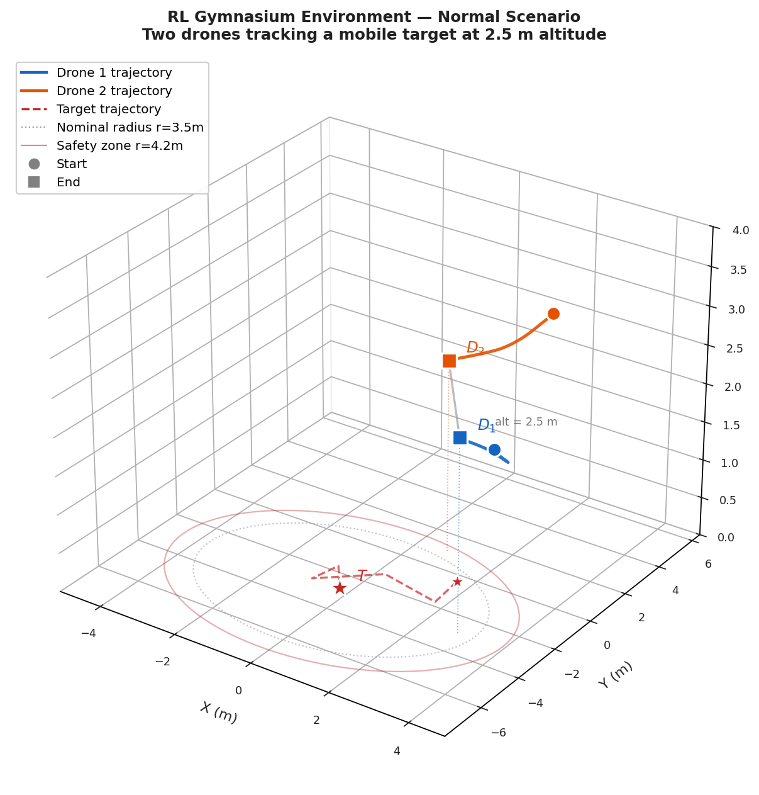
  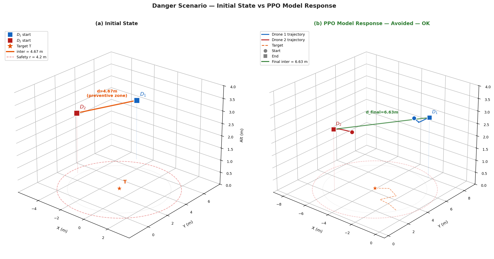
</p>
<p align="center"><em>Left: Normal tracking scenario. Right: Danger scenario triggering RL collision avoidance</em></p>

---

## Simulation Environment

The simulation runs on **Gazebo Garden** with a realistic outdoor terrain (Baylands) and a walking human actor:

<p align="center">
  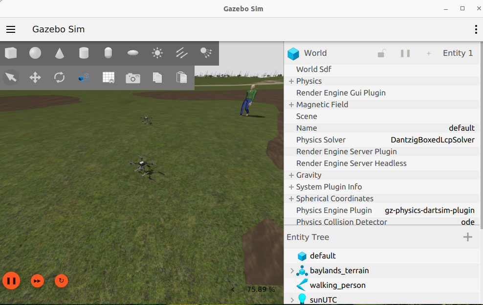
</p>

### Simulation Setup
- **Two X500 quadcopters** with depth cameras (OakD-Lite model)
- **Walking human actor** following a predefined path
- **Baylands terrain** for realistic outdoor environment
- **PX4 SITL** flight controller for each drone
- **Micro XRCE-DDS** bridge connecting PX4 to ROS2

### Launch Procedure
The entire simulation is orchestrated via a single bash script that spawns **13 terminal sessions**:

`
 1.  XRCE-DDS Agent            7.  Depth Bridge Drone 2
 2.  QGroundControl             8.  Dynamic Pose Bridge
 3.  PX4 Drone 1               9.  WebSocket Client -> Jetson
 4.  PX4 Drone 2              10.  YOLO (on Jetson via WS)
 5.  RGB Bridge Drone 1       11.  CollabTracker Drone 1
 6.  RGB Bridge Drone 2       12.  CollabTracker Drone 2
                               13.  Depth Bridge Drone 1
`

<p align="center">
  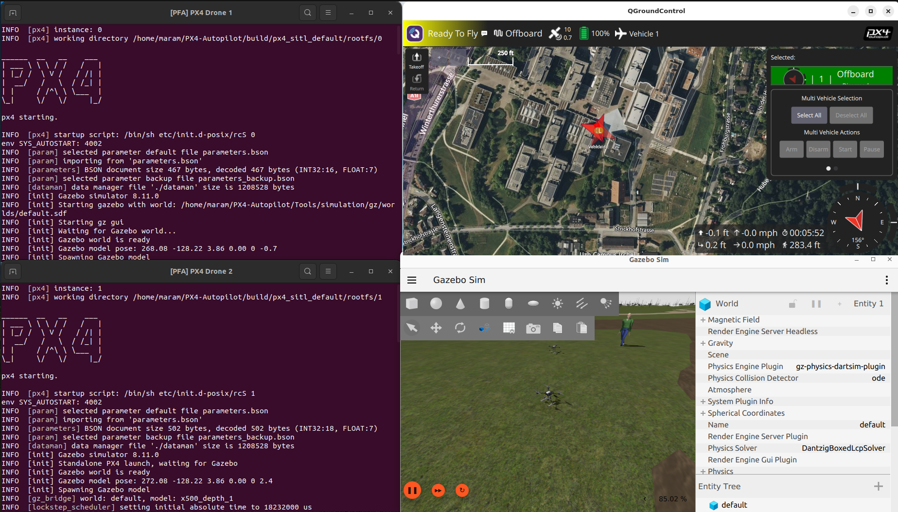
</p>

---

## HITL — Hardware-in-the-Loop with Jetson Nano

The **HITL architecture** offloads computationally expensive AI inference to an **NVIDIA Jetson Nano**, allowing real-time performance without overwhelming the simulation host:

<p align="center">
  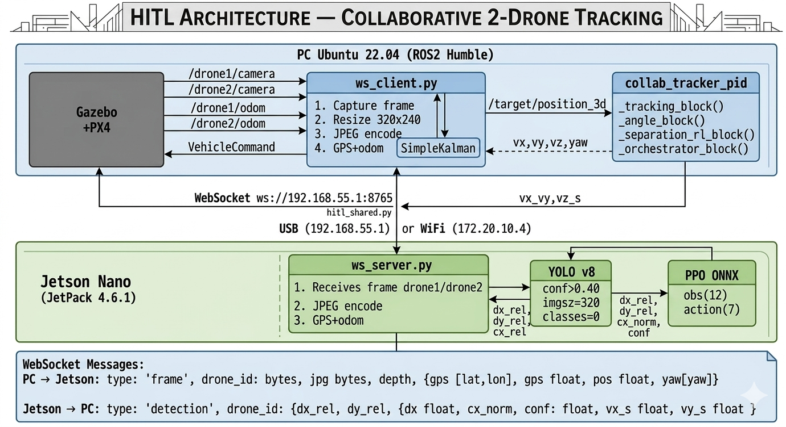
</p>

| Component | Runs On | Role |
|-----------|---------|------|
| PX4 + Gazebo | Host PC | Physics simulation |
| PID Controller | Host PC | Real-time tracking control |
| ROS2 Bridges | Host PC | Sensor data transport |
| **YOLOv8 (ONNX)** | **Jetson Nano** | Person detection |
| **PPO Agent (ONNX)** | **Jetson Nano** | Collision avoidance decisions |
| WebSocket | Network | Bidirectional communication |

### Communication Protocol
`
PC -> Jetson:  Camera frames (JPEG compressed) + Odometry data
Jetson -> PC:  Detection results + RL separation commands (vx_s, vy_s)
`

---

## Results

### PID vs PID+RL Comparison
<p align="center">
  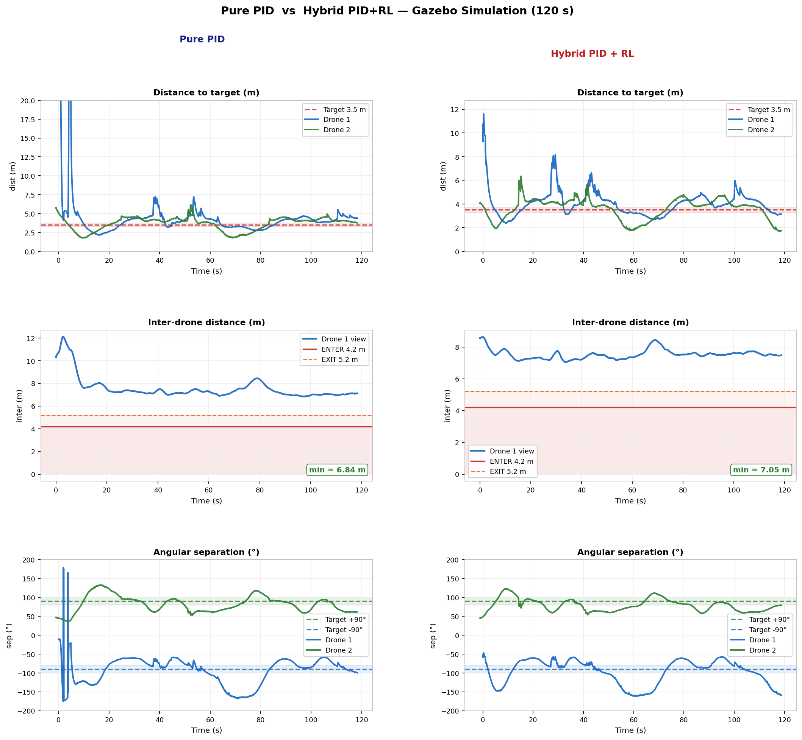
</p>

### State Machine Architecture
<p align="center">
  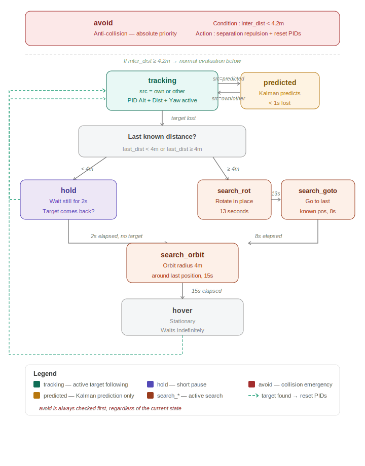
</p>

### Key Metrics

| Metric | Value |
|--------|-------|
| Detection FPS (Jetson) | ~8-12 FPS |
| Control Loop Rate | 20 Hz |
| Target Distance Accuracy | 3.5m +/- 0.5m |
| Collision Avoidance Rate | >95% (RL) vs ~70% (PID only) |
| YOLO Inference (Jetson) | ~80ms |
| PPO Inference (Jetson) | <5ms |
| WebSocket Latency | ~15ms |

---

## Project Structure

`
drone-collaborative-tracking/
├── README.md
├── LICENSE
├── docs/
│   ├── images/              # Screenshots and results
│   └── diagrams/            # Architecture & flow diagrams
└── examples/
    └── pid_controller.py    # Example: PID controller implementation
`

> **Note:** The full source code, trained models, and simulation configurations are kept private. This repository showcases the architecture, methodology, and results of the project. For inquiries about the implementation, please reach out.

---

## Author

**Eya Badri**
- Engineering Student — ENIT, Universite de Tunis El Manar
- eya.badri@etudiant-enit.utm.tn
- [GitHub](https://github.com/eyabadri)

---

## License

This project is for **academic and demonstration purposes only**. The architecture design, trained models, and proprietary algorithms remain the intellectual property of the author.

 2026 Eya Badri — All Rights Reserved
